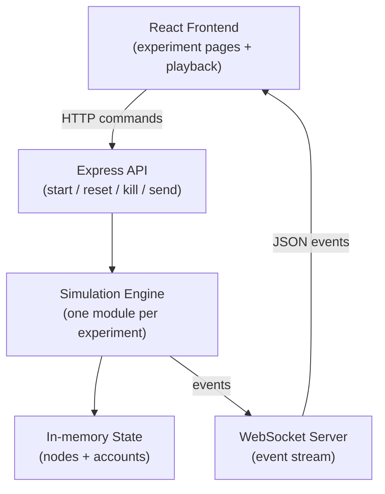
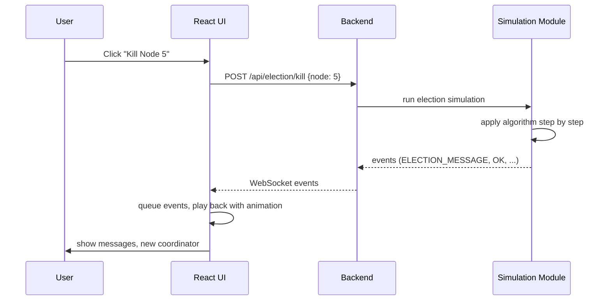
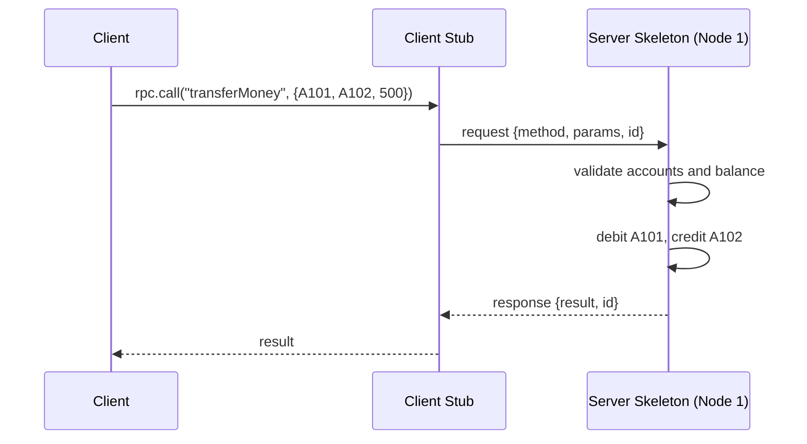
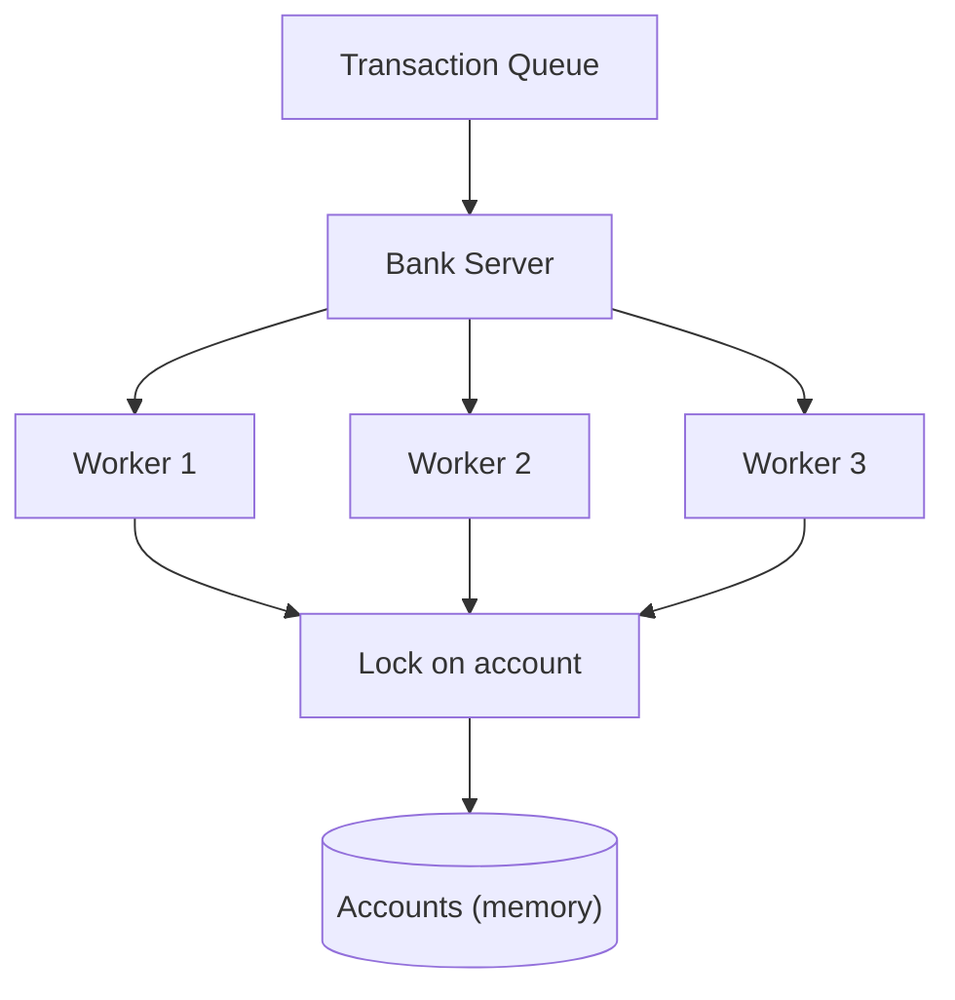
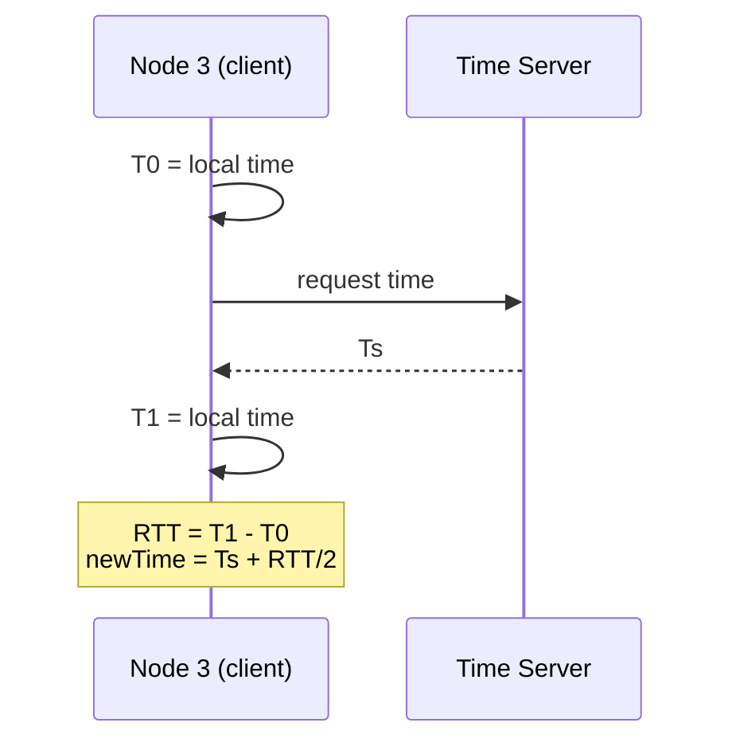
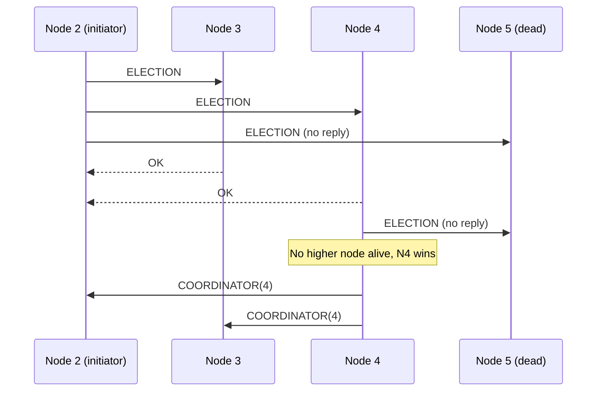
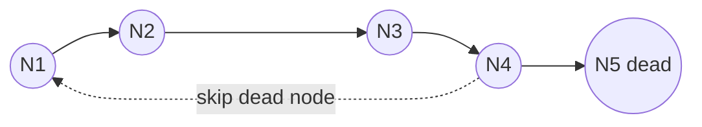
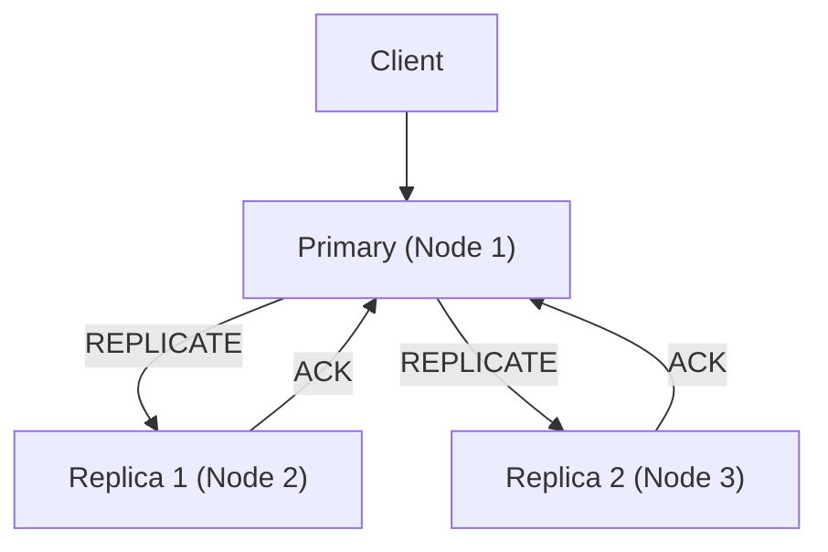
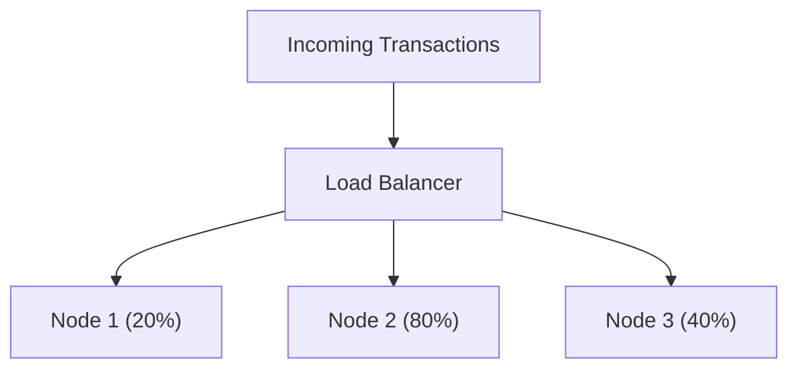
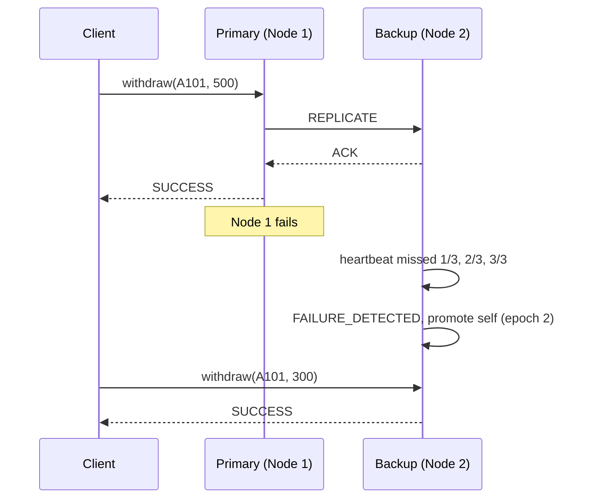

# Distributed Bank Transaction Processing System
### Simplified Project Specification (Simulation-Only Version)
**Distributed Computing Laboratory Project**

> **What makes this version simple**
> - Every "node" is a **JavaScript object inside one backend process**. There are no separate node processes and no node-to-node HTTP calls.
> - Every experiment is a **simulation**: the backend runs the algorithm step by step and emits events, and the React UI plays them back visually.
> - **No database.** All data is *in-memory simulated bank account state*.
> - **Docker is not required.** It appears only as an optional extra for Experiment 7 (see Section 20).
>
> The full, more realistic version (real processes, Docker nodes) is in `DISTRIBUTED_BANK_PROJECT_SPEC.md`. This file is the lighter alternative.

---

## Table of Contents

1. [Overview](#1-overview)
2. [Scope and Limitations](#2-scope-and-limitations)
3. [Technology Stack](#3-technology-stack)
4. [Architecture](#4-architecture)
5. [Simulation Model](#5-simulation-model)
6. [Events and WebSocket](#6-events-and-websocket)
7. [Experiment 1: RPC](#7-experiment-1--rpc)
8. [Experiment 2: Multithreading](#8-experiment-2--multithreading)
9. [Experiment 3: Clock Synchronization](#9-experiment-3--clock-synchronization)
10. [Experiment 4: Bully and Ring Election](#10-experiment-4--bully-and-ring-election)
11. [Experiment 5: Consistency and Replication](#11-experiment-5--data-consistency-and-replication)
12. [Experiment 6: Load Balancing](#12-experiment-6--load-balancing)
13. [Experiment 7: Fault Tolerance](#13-experiment-7--primary-backup-fault-tolerance)
14. [Frontend](#14-frontend)
15. [Folder Structure](#15-folder-structure)
16. [Implementation Plan](#16-implementation-plan)
17. [Testing](#17-testing)
18. [Demo Flow](#18-demo-flow)
19. [Viva Questions](#19-viva-questions-and-answers)
20. [Optional Docker and Future Work](#20-optional-docker-and-future-work)

---

## 1. Overview

**Project:** an interactive simulator that uses one bank-transaction scenario to demonstrate seven distributed computing experiments:

| # | Experiment | What is demonstrated |
|---|---|---|
| 1 | RPC | Client calls `transferMoney()` on a remote bank server |
| 2 | Multithreading | Concurrent transactions, race condition, mutex fix |
| 3 | Clock Synchronization | Cristian, Berkeley, Lamport |
| 4 | Election | Bully and Ring algorithms |
| 5 | Consistency and Replication | Strong vs eventual consistency |
| 6 | Load Balancing | Round Robin, Least Connections, Weighted Round Robin |
| 7 | Fault Tolerance | Primary-backup failover |

**Core idea:** all seven experiments use the **same simulated bank network** (the same nodes, accounts and transactions), so the project reads as one coherent distributed system and not seven separate programs.

**Banking is a case study only.** This is a lab simulation, not a real banking application.

---

## 2. Scope and Limitations

**In scope**
- 7 experiment pages in a React app
- A single Node.js backend that runs the simulations
- WebSocket event stream for live visualisation
- Dummy in-memory accounts

**Out of scope (on purpose)**
Databases, authentication, real payments, real networking between processes, Kubernetes, Kafka, Redis, cloud deployment, consensus protocols like Raft/Paxos.

**Why no database?** The goal is to show distributed *algorithms*, not data storage. A database would hide the behaviour we want to show (locking, replication, staleness), and in-memory data resets instantly.

**What is real and what is simulated**

| Real | Simulated |
|---|---|
| React UI, Express API, WebSocket events | Bank nodes (objects in memory) |
| The algorithms themselves (Bully, Ring, Lamport, etc.) | Network messages (events with artificial delays) |
| | Node crashes (an `alive = false` flag) |
| | Clock skew, server load, worker threads |

The algorithms are implemented for real. Only the *environment* (nodes, network, failures) is simulated, and that should be stated clearly in the viva.

---

## 3. Technology Stack

| Layer | Technology |
|---|---|
| Frontend | React (JavaScript), HTML, CSS (Tailwind optional) |
| Visualisation | Plain SVG/CSS animation; optional **React Flow** for node graphs, **Recharts** for charts |
| Backend | Node.js + Express |
| Real-time | WebSocket (`ws` library) |
| Storage | None (in-memory JavaScript objects) |
| Docker | **Not required** |

Keep dependencies minimal: `express`, `ws`, `cors` on the backend; `react`, `react-router-dom` (plus optionally `reactflow`, `recharts`) on the frontend.

---

## 4. Architecture

### 4.1 Overview



### 4.2 How a simulation runs



### 4.3 Key rules

1. **The backend runs the algorithm; the UI only draws it.** The UI contains no algorithm logic.
2. **Events are the only communication from backend to UI.** Everything visible on screen comes from an event.
3. **The UI plays events from a queue**, so Pause, Step and Speed are implemented purely in the frontend.
4. **Nodes are plain objects** in a shared `network` structure; "sending a message" means pushing an event and calling the receiving node's handler function after a simulated delay.

---

## 5. Simulation Model

### 5.1 Accounts (seed data, reset on every experiment)

```javascript
const accounts = {
  A101: { name: "Rahul", balance: 10000 },
  A102: { name: "Priya", balance: 15000 },
  A103: { name: "Aman",  balance: 8000  },
  A104: { name: "Neha",  balance: 12000 },
};
```

### 5.2 Nodes

```javascript
const nodes = [1, 2, 3, 4, 5].map(id => ({
  id,
  name: `Bank Node ${id}`,
  alive: true,          // crash = false
  role: "idle",         // coordinator | primary | replica | backup | worker
  clockOffset: 0,       // clock experiment
  lamport: 0,           // clock experiment
  load: 0,              // load balancing
  accounts: structuredClone(seedAccounts)   // each node has its own copy
}));
```

Each node has its **own copy** of the accounts. That is what makes replication and stale data visible.

### 5.3 Which nodes each experiment uses

| Experiment | Nodes |
|---|---|
| RPC | Client + Node 1 (server) |
| Multithreading | One server with 3 workers |
| Clock | Nodes 1 to 4 |
| Election | Nodes 1 to 5 |
| Replication | Node 1 (primary), Nodes 2 and 3 (replicas) |
| Load balancing | Nodes 1 to 3 |
| Fault tolerance | Node 1 (primary), Node 2 (backup) |

### 5.4 Simulated time and network

- Simulation uses its own **tick counter** or timestamps. It never waits in real time.
- A helper `send(from, to, type, data)` records a `MESSAGE_SENT` event, and if the receiver is alive it calls the receiver's handler; if it is dead the message is simply lost (timeout is simulated by a later event).
- The UI controls the **display speed**, so there is no need for real timeouts in the backend.

---

## 6. Events and WebSocket

### 6.1 Event format

```json
{
  "id": 17,
  "time": "10:21:04",
  "experiment": "election",
  "type": "ELECTION_MESSAGE",
  "data": { "from": 2, "to": 4, "kind": "ELECTION" }
}
```

### 6.2 Event types

| Group | Types |
|---|---|
| General | `SIM_STARTED`, `SIM_RESET`, `MESSAGE_SENT`, `MESSAGE_RECEIVED`, `NODE_FAILED`, `NODE_RECOVERED` |
| Transactions | `TRANSACTION_STARTED`, `TRANSACTION_COMPLETED`, `TRANSACTION_FAILED` |
| RPC | `RPC_REQUEST`, `RPC_PROCESSING`, `RPC_RESPONSE` |
| Multithreading | `TRANSACTION_QUEUED`, `WORKER_ASSIGNED`, `LOCK_ACQUIRED`, `LOCK_RELEASED`, `RACE_DETECTED` |
| Clock | `CLOCK_UPDATED`, `LAMPORT_EVENT` |
| Election | `ELECTION_STARTED`, `ELECTION_MESSAGE`, `COORDINATOR_ELECTED` |
| Replication | `REPLICATION_STARTED`, `REPLICATION`, `REPLICATION_COMPLETED` |
| Load balancing | `NODE_SELECTED`, `LOAD_UPDATED` |
| Failover | `HEARTBEAT_MISSED`, `FAILURE_DETECTED`, `PRIMARY_CHANGED` |

### 6.3 Playback

The frontend keeps an **event queue**. A timer takes the next event every *N* ms (N depends on the speed slider), updates the UI state and appends it to the log. This gives **Start / Pause / Step / Reset** with almost no extra code.

### 6.4 REST endpoints (commands only)

| Method | Path | Purpose |
|---|---|---|
| POST | `/api/reset` | Reset all state |
| POST | `/api/rpc/transfer` | Run RPC transfer |
| POST | `/api/threads/run` | Run multithreading demo (mode + transactions) |
| POST | `/api/clock/sync` | Run Cristian / Berkeley / Lamport |
| POST | `/api/election/start` | Run Bully or Ring (with failed nodes) |
| POST | `/api/replication/write` | Withdraw with strong or eventual mode |
| POST | `/api/load/send` | Send N transactions with chosen algorithm |
| POST | `/api/failover/run` | Transaction, fail primary, promote backup |
| POST | `/api/nodes/:id/kill` · `/recover` | Toggle `alive` flag |

---

## 7. Experiment 1 — RPC

**Concept.** A client calls a procedure that runs on a remote server as if it were a local function. A **client stub** packs ("marshals") the call into a message; a **server skeleton** unpacks it, runs the procedure and returns the result.

**RPC vs plain HTTP.** RPC hides the network behind a function call (`transferMoney(...)`); REST exposes resources and verbs (`POST /transfers`). In this simulation, the abstraction is RPC.

**Scenario.** Transfer ₹500 from A101 to A102.



**Algorithm (simulation steps)**
1. Emit `RPC_REQUEST` with method and params.
2. Server looks up the method name in a small registry (`transferMoney`, `getBalance`).
3. Validate: accounts exist, `amount > 0`, `balance >= amount`.
4. Update balances, emit `RPC_PROCESSING` for each stage (receive, validate, execute).
5. Emit `RPC_RESPONSE` with the result or an error.

**UI.** Client box and Server box with an animated request arrow and response arrow; four stage lights on the server (*Receive, Validate, Execute, Respond*); a panel showing the raw request/response JSON; before/after balances.

**Controls.** `[Send Transfer]` `[Edit from / to / amount]` `[Toggle Server Down]` `[Reset]`

**Expected log**
```text
[10:21:03] Client sent transfer request
[10:21:03] Server received RPC request
[10:21:03] Validating source account
[10:21:04] Transaction processed (A101: 10000 → 9500, A102: 15000 → 15500)
[10:21:04] Response sent to client
```

**Failure cases.** Invalid account, insufficient balance, server down (client shows `TIMEOUT`).

**Viva**
- *What is a stub?* A client-side proxy that looks like a local function but sends the call over the network.
- *What is marshalling?* Packing parameters into a transmittable format (JSON here).
- *What if the server crashes mid-call?* The client times out and cannot tell whether the call ran.

---

## 8. Experiment 2 — Multithreading

**Concept.** A server handles many requests at once using worker threads. If two workers update the same balance without coordination, a **race condition** corrupts data. A **mutex (lock)** or a serial queue prevents it.

**Approach (simulated only).** Workers are simulated as tasks that move through three steps: *read → compute (takes time) → write*. The simulation interleaves them to show what happens with and without a lock. No real threads are used.

**Scenario**
```text
T1: A101 → A102  ₹500
T2: A103 → A101  ₹200
T3: A102 → A103  ₹1000
T4: A101 → A103  ₹300
```
and the race demo:
```text
A101 = ₹1000
Worker 1 reads 1000   Worker 2 reads 1000
Worker 1 withdraws 800 → writes 200
Worker 2 withdraws 700 → writes 300      ← wrong! (₹1500 withdrawn from ₹1000)
```



**Algorithm**
- **Dispatcher:** while the queue is not empty and a worker is idle, assign the next transaction.
- **Unsafe mode:** worker reads balance, waits (simulated processing time), writes `readValue − amount`. Another worker can read the old value in between.
- **Mutex mode:** worker must acquire the lock for the account first; others wait. Release after write.
- **Queue mode (optional):** all operations on one account go through one single-worker queue.
- At the end, compute the **expected** result by running the same transactions one after another, and compare it with the actual result. If they differ, emit `RACE_DETECTED`.

**UI.** Queue (left), three worker lanes with progress bars (middle), account balances (right), lock icon on locked accounts, a red **RACE DETECTED** banner showing expected vs actual.

**Controls.** `[Add Transaction]` `[Run Batch]` `[Run Race Demo]` `[Mode: Unsafe | Mutex]` `[Workers: 1–3]` `[Pause]` `[Step]` `[Reset]`

**Expected output**
```text
UNSAFE: final A101 = 300, expected 200  → RACE DETECTED
MUTEX : Worker 2 waits for lock, then fails (insufficient funds). Final A101 = 200 ✔
```

**Edge cases.** Insufficient funds under lock (clean failure), same account accessed by all workers, 1 worker vs 3 workers.

**Viva**
- *Is Node.js multithreaded?* JS runs on one thread, but interleaving at `await` points can still cause races; `worker_threads` give true parallelism.
- *What is a race condition?* The result depends on timing of concurrent access to shared data.
- *How do you avoid deadlock?* Always acquire locks in a fixed order (e.g. sorted account ID).

---

## 9. Experiment 3 — Clock Synchronization

**Concept.** Each node's clock has an offset and drift. Cross-node timestamps are unreliable unless clocks are synchronised. This experiment covers two physical-clock algorithms (**Cristian**, **Berkeley**) and one logical-clock algorithm (**Lamport**).

**Simulated clocks.** Each node has `clockOffset` (in seconds) added to a base simulated time.

```text
Node 1 → 10:00:05  (+5 s)
Node 2 → 10:00:12  (+12 s)
Node 3 → 09:59:57  (−3 s)
Node 4 → 10:00:08  (+8 s)
Reference time → 10:00:00
```

**Scenario.** Two nodes log "transfer committed". With wrong clocks, a later transaction appears earlier in the audit log. After synchronisation the order is correct.

### 9.1 Cristian's algorithm (client + time server)



```text
RTT = T1 − T0
newTime = Ts + RTT / 2
error ≤ RTT / 2
```

### 9.2 Berkeley algorithm (no external time source)

```text
1. Master asks every node for its time.
2. Master computes each node's offset relative to itself.
3. Master averages all offsets (ignoring extreme outliers).
4. Master sends each node an ADJUSTMENT (average − that node's offset).
5. Each node adds its adjustment.
```

Example: offsets `[0, +7, −8, +3]` → average `+0.5` → adjustments `[+0.5, −6.5, +8.5, −2.5]`.

### 9.3 Lamport logical clock

```text
Local event:      L = L + 1
Send message:     L = L + 1, attach L
Receive message:  L = max(L, Lm) + 1
```

```text
Node 1              Node 2              Node 3
Event A (L=5)
   └──────────────────►
                     Event B (L=9)
                        └──────────────────►
                                         Event C (L=12)
```

If A happened before B, then `L(A) < L(B)`. The reverse is not guaranteed (that needs vector clocks).

**UI.** Four clock displays with offset badges; algorithm tabs (Cristian | Berkeley | Lamport); before/after table; for Lamport a space-time diagram (one horizontal line per node, arrows for messages, `L` value on each event).

**Controls.** `[Randomise Offsets]` `[Algorithm]` `[Synchronize Clocks]` `[Send Message A→B]` `[Local Event]` `[Reset]`

**Expected output**
```text
Before: N1 +5.0s   N2 +12.0s   N3 −3.0s   N4 +8.0s
After Berkeley: all nodes within ±0.5 s
```

**Edge cases.** Already-synchronised clocks (adjustments ≈ 0), very large offsets, high or uneven delay (Cristian error grows).

**Viva**
- *How does Cristian estimate network delay?* One-way ≈ RTT/2, assuming symmetric delay.
- *Cristian vs Berkeley?* Cristian needs an authoritative time server; Berkeley averages the group.
- *Why use logical clocks?* Only the order of events matters, not real time.

---

## 10. Experiment 4 — Bully and Ring Election

**Concept.** When the coordinator fails, the remaining nodes must elect a new one. The node with the **highest ID among alive nodes** should win.

**Setup.** Nodes 1 to 5, Node 5 is the coordinator. The user clicks **Kill Node 5**. A node (e.g. Node 2) notices (simulated "no heartbeat reply") and starts an election.

### 10.1 Bully algorithm



**Rules**
1. A node that detects failure sends `ELECTION` to all nodes with **higher** IDs.
2. A higher alive node replies `OK` and starts its own election.
3. A node that gets no `OK` declares itself coordinator and sends `COORDINATOR(id)` to all.

### 10.2 Ring algorithm



**Rules**
1. Nodes form a logical ring in ID order.
2. The initiator sends `ELECTION [id]` to the next **alive** node (dead nodes are skipped).
3. Each node appends its own ID and forwards the list.
4. When the list returns to the initiator, the highest ID is the coordinator.
5. The initiator sends `COORDINATOR(id)` around the ring once.

```text
Node 2 starts: [2] → [2,3] → [2,3,4] → (5 dead, skip) → [2,3,4,1] → back to Node 2
Highest = 4  →  COORDINATOR(4)
```

**UI.** Toggle `[Bully | Ring]`. Bully shows a full mesh of nodes; Ring shows a circle. Nodes: green alive, red dead, gold ⭐ coordinator, purple initiator. Animated message dots labelled `ELECTION`, `OK`, `COORDINATOR` (or the token with its collected ID list in Ring mode).

**Controls.** `[Algorithm]` `[Kill Node N]` `[Recover Node N]` `[Start Election From Node X]` `[Pause]` `[Step]` `[Reset]`

**Expected log**
```text
[10:21:03] Node 2 detected coordinator failure
[10:21:04] Node 2 → Node 3 : ELECTION
[10:21:04] Node 2 → Node 4 : ELECTION
[10:21:05] Node 4 → Node 2 : OK
[10:21:06] Node 4 elected as coordinator
```

**Edge cases.** Coordinator fails; multiple nodes fail (5 and 4 → Node 3 wins); lowest-ID initiator (most messages); highest alive node initiates (wins immediately); only one node alive; old coordinator recovers.

**Viva**
- *Why "Bully"?* The highest-ID node forces lower ones to give up.
- *Message complexity?* Bully worst case O(n²); Ring about 2n.
- *What does `OK` mean?* "I'm alive and have a higher ID, I'll take over." It does not mean the sender is the coordinator.

---

## 11. Experiment 5 — Data Consistency and Replication

**Concept.** Replication keeps copies of data on several nodes. The question is when copies agree.

| Model | Behaviour | Trade-off |
|---|---|---|
| **Strong** | Write is confirmed only after **all** replicas have it | Slower; blocked if a replica is down |
| **Eventual** | Primary confirms immediately; replicas update **later** | Fast; replicas are temporarily stale |

**Scenario**
```text
Primary (Node 1): A101 = 10000
Replica 1 (Node 2): A101 = 10000
Replica 2 (Node 3): A101 = 10000
Operation: Withdraw ₹2000
```



**Algorithm**
- Each balance carries a **version number**; a replica with a lower version than the primary is *stale*.
- **Strong:** primary applies the update, sends `REPLICATE` to both replicas, waits for both `ACK`s, then confirms to the client.
- **Eventual:** primary applies and confirms immediately; `REPLICATE` messages are delivered after a configurable **delay per replica**.
- A replica ignores a `REPLICATE` with a version that is not newer.

**UI.** Three node cards showing balance and version; animated `REPLICATE` / `ACK` messages; amber `STALE` badge on out-of-date replicas; mode switch; "Read from replica" button to show a stale read; a small chart of the three balances over time.

**Controls.** `[Mode: Strong | Eventual]` `[Withdraw ₹]` `[Replica delays]` `[Read from: Primary | R1 | R2]` `[Kill/Recover Replica]` `[Reset]`

**Expected output**
```text
Strong:   Primary 8000 | R1 8000 | R2 8000   (confirmed after both ACKs)
Eventual: t=0  Primary 8000 | R1 10000 STALE | R2 10000 STALE
          t=2  Primary 8000 | R1 8000        | R2 10000 STALE
          t=3  Primary 8000 | R1 8000        | R2 8000  (converged)
```

**Edge cases.** Strong mode with a dead replica (write blocked); eventual mode with a dead replica (catches up on recovery); long delay; insufficient funds (rejected at primary).

**Viva**
- *Strong vs eventual?* Strong waits for all replicas; eventual replies first and converges later.
- *Why version numbers?* To detect stale replicas and ignore old updates.
- *CAP theorem?* During a failure you choose consistency (strong) or availability (eventual).

---

## 12. Experiment 6 — Load Balancing

**Concept.** A load balancer spreads incoming requests across servers to avoid overloading any one of them.



**Simulation.** Each node has `activeConnections` and a capacity (default 10). Each request occupies a node for a random number of ticks, then releases it. `load% = activeConnections / capacity × 100`.

**Algorithms**

| Algorithm | Rule | Example |
|---|---|---|
| **Round Robin** | Cycle through nodes in order, ignoring load | T1→N1, T2→N2, T3→N3, T4→N1 |
| **Least Connections** | Pick the node with the fewest active connections | N1=2, N2=7, N3=3 → N1 |
| **Weighted Round Robin** | Nodes with higher weight get more requests per cycle | Weights 1:3:2 → N1, N2, N2, N2, N3, N3 |

A node with `alive = false` is skipped by every algorithm.

**UI.** Load balancer on top, nodes below with a **load meter** (bar, percentage, active requests); transaction dots moving to the chosen node; algorithm selector; bar chart of total requests per node; comparison of the same stream under two algorithms.

**Controls.** `[Algorithm]` `[Send 1]` `[Send Burst (n)]` `[Set Weights]` `[Set Initial Load]` `[Kill/Recover Node]` `[Reset]`

**Expected output**
```text
Round Robin:       12 / 12 / 12 requests, but Node 2 reaches 95% load
Least Connections: 15 / 6 / 15 requests, load stays balanced
```

**Edge cases.** Equal loads (ties go to the lowest ID), unequal loads, node fails mid-stream, all nodes down (`NO_AVAILABLE_NODES`), weight 0.

**Viva**
- *Why can Round Robin be bad?* It ignores actual load and request cost.
- *When is Least Connections best?* When request durations vary a lot.
- *Single point of failure?* The load balancer itself.

---

## 13. Experiment 7 — Primary-Backup Fault Tolerance

**Concept.** The system keeps working when a node fails. The **primary** handles transactions and copies each one to a **backup**. If the primary fails, the backup is **promoted**.

*How this differs from Experiment 5:* Experiment 5 studies *when replicas agree*. Experiment 7 studies *failure detection and takeover*.

**Scenario**
```text
Normal:  Primary (Node 1) ACTIVE, Backup (Node 2) ACTIVE
Txn:     A101 5000 → 4500 on both
Failure: Primary ❌
Result:  Node 2 becomes NEW PRIMARY and processes the next transaction
```



**Algorithm**
1. Primary replicates every transaction synchronously to the backup and sends a heartbeat each tick.
2. If the backup misses **3 heartbeats** in a row, it emits `FAILURE_DETECTED`.
3. The backup sets `role = primary` and increments the **epoch** (term number). Emit `PRIMARY_CHANGED`.
4. New transactions go to the new primary (the simulation keeps a `currentPrimary` variable).
5. **Recovery:** the old primary returns, sees a higher epoch, becomes a backup, and copies the current balances from the new primary.

**UI.** Two server boxes with status badges (`ACTIVE`, `FAILED`, `NEW PRIMARY`, `RECOVERING`); heartbeat pulse with a missed-beat counter; timeline strip `Primary ❌ → Failure detected → Backup promoted → ⭐ New primary`; client arrow switching from Node 1 to Node 2; balances on both nodes.

**Controls.** `[Send Transaction]` `[Fail Primary]` `[Recover Node]` `[Reset]`

**Expected log**
```text
[10:30:01] Txn T-12 committed on Node 1 and replicated to Node 2 (A101 = 4500)
[10:30:05] Node 1 FAILED
[10:30:06] Node 2: heartbeat missed (1/3)
[10:30:08] Node 2: heartbeat missed (3/3), failure detected
[10:30:08] Node 2 promoted to PRIMARY (epoch 2)
[10:30:09] Txn T-13 committed on Node 2 (A101 = 4200)
[10:30:20] Node 1 recovered, now BACKUP (synced from Node 2)
```

**Edge cases.** Primary fails; backup fails (primary continues, "no backup" warning); both fail; transaction in flight at crash (client retries with the same transaction ID); old primary returns (epoch check makes it step down).

**Viva**
- *How does the backup detect failure?* Missed heartbeats beyond a threshold.
- *What if the primary is only slow?* Two primaries could exist (split-brain); epoch numbers make the older one step down.
- *Why replicate synchronously?* So no committed transaction is lost during failover.

---

## 14. Frontend

### 14.1 Pages

| Page | Route | Main visual |
|---|---|---|
| Dashboard | `/` | Node summary (total / active / failed), current coordinator and primary, links to experiments |
| RPC | `/rpc` | Client ↔ Server arrows, JSON panel |
| Multithreading | `/threads` | Queue → worker lanes → accounts |
| Clock | `/clock` | Clocks, offsets, Lamport diagram |
| Election | `/election` | Mesh or ring of nodes, message animation |
| Replication | `/replication` | Primary + 2 replicas with versions |
| Load Balancing | `/load` | Balancer, nodes, load meters |
| Fault Tolerance | `/failover` | Primary/Backup, heartbeat, timeline |

### 14.2 Layout used on every experiment page

1. Short concept explanation
2. Banking scenario
3. Main visualisation area
4. Controls (Start / Pause / Step / Reset + experiment-specific buttons)
5. Parameters
6. Event log
7. Node state panel
8. Result banner

### 14.3 Reusable components

| Component | Used for |
|---|---|
| `NodeCard` | Node ID, status, role, balance summary |
| `StatusBadge` | ACTIVE / FAILED / COORDINATOR / PRIMARY / STALE |
| `EventLog` | Timestamped event list |
| `SimulationControls` | Start, Pause, Step, Reset, speed slider |
| `ExperimentDescription` | Collapsible concept + scenario |
| `ConnectionLine` | Animated message arrow between nodes |
| `NodeGraph` | Mesh or ring layout of nodes |
| `TransactionCard` / `TransactionQueue` | Transaction lists |
| `LoadMeter` | Load bar and percentage |
| `ClockDisplay` | Clock with offset |
| `ReplicationPanel` | Primary and replicas side by side |
| `ResultBanner` | Final outcome |

### 14.4 State handling

A single `useSimulation` hook: opens the WebSocket, pushes incoming events into a queue, plays them at the chosen speed and exposes `state`, `log`, `play()`, `pause()`, `step()`, `reset()`. Experiment pages differ only in how they *draw* the state. React Context is enough, so Redux is not needed.

---

## 15. Folder Structure

```text
distributed-bank/
│
├── frontend/
│   ├── src/
│   │   ├── components/          # NodeCard, EventLog, StatusBadge, ...
│   │   ├── pages/               # Dashboard.jsx
│   │   ├── experiments/
│   │   │   ├── rpc/
│   │   │   ├── multithreading/
│   │   │   ├── clock/
│   │   │   ├── election/
│   │   │   ├── replication/
│   │   │   ├── loadBalancing/
│   │   │   └── faultTolerance/
│   │   ├── hooks/               # useSimulation.js
│   │   ├── services/            # api.js, socket.js
│   │   └── App.jsx
│   └── package.json
│
├── backend/
│   ├── src/
│   │   ├── server.js            # Express + WebSocket setup
│   │   ├── routes.js            # REST endpoints
│   │   ├── events.js            # emit(), event type constants
│   │   ├── state.js             # seed accounts + nodes, reset()
│   │   └── simulations/
│   │       ├── rpc.js
│   │       ├── multithreading.js
│   │       ├── clock.js         # cristian, berkeley, lamport
│   │       ├── election.js      # bully, ring
│   │       ├── replication.js
│   │       ├── loadBalancing.js
│   │       └── faultTolerance.js
│   └── package.json
│
└── README.md
```

Each file in `simulations/` exports one function that takes the current state and parameters, calls `emit()` for every step, and returns the final result.

---

## 16. Implementation Plan

Each phase ends with something you can run and check.

| Phase | Build | Test |
|---|---|---|
| 1 | React skeleton: routes, Dashboard, empty experiment pages | Every route loads |
| 2 | Express backend + `state.js` (nodes and accounts) + reset | `GET /api/state` returns 5 nodes |
| 3 | WebSocket + `emit()` + `useSimulation` hook + `EventLog` | A test event shows up in the browser log |
| 4 | **RPC** simulation and page | Transfer works; insufficient funds shows an error |
| 5 | **Multithreading** simulation and page | Unsafe shows a race, mutex fixes it |
| 6 | **Clock** (Cristian, Berkeley, Lamport) | Numbers match hand calculation |
| 7 | **Election** (Bully, Ring) | Killing Node 5 gives coordinator 4 in both algorithms |
| 8 | **Replication** (strong, eventual) | Stale window visible in eventual mode |
| 9 | **Load balancing** (3 algorithms) | Distribution differs between algorithms |
| 10 | **Fault tolerance** (heartbeat, promotion) | Next transaction succeeds on Node 2 |
| 11 | Polish: animations, speed slider, result banners, viva notes | Full demo runs smoothly |
| 12 | Testing and viva preparation | Two clean dry runs |

**Order rationale:** RPC first because it validates the whole UI ↔ backend ↔ events loop with the simplest logic. Replication before fault tolerance because failover reuses it.

---

## 17. Testing

Each experiment is checked for **Normal**, **Failure**, **Edge** and **Reset** behaviour.

| Experiment | Normal | Failure | Edge | Reset |
|---|---|---|---|---|
| RPC | ₹500 transfer correct | Insufficient funds, invalid account, server down | Amount 0 or negative | Balances back to seed |
| Multithreading | 4 transactions complete | Insufficient funds under lock | Same account in all workers; lock on vs off | Queue cleared |
| Clock | All 3 algorithms correct | Node unreachable during sync | Huge offsets; already synchronised | Offsets restored |
| Election | Node 5 dies → Node 4 wins | Failure during election | Multiple failures; lowest-ID initiator; single node alive | Node 5 coordinator again |
| Replication | Strong all 8000; eventual converges | Replica down | Long delay; insufficient funds | Versions 0 |
| Load balancing | RR cycles N1, N2, N3 | Node fails mid-stream | Equal vs unequal loads; all down | Stats zeroed |
| Fault tolerance | Txn replicated | Primary fails → promotion | In-flight txn; old primary returns | Node 1 primary again |

**Unit-test the pure algorithm functions** (easy because they are plain functions): Lamport rule, Cristian formula, Berkeley averaging, Bully/Ring winners, load-balancer pickers.

```text
Lamport:   local L=8, receive Lm=5  → 9;   receive Lm=12 → 13
Cristian:  T0=100, T1=300, Ts=1000  → newTime = 1100
Berkeley:  offsets [0,+7,−8,+3]     → adjustments [+0.5, −6.5, +8.5, −2.5]
Bully:     alive {1,2,3,4}          → winner 4
Ring:      list [2,3,4,1]           → winner 4
```

---

## 18. Demo Flow

About 10 to 12 minutes. Press **Reset All** between demos.

| # | Demo | What the examiner sees |
|---|---|---|
| 1 | **Dashboard** | 5 active nodes, Node 5 coordinator, Node 1 primary, seven experiment cards |
| 2 | **RPC** | Request and response arrows; balances 10000→9500 and 15000→15500; then an insufficient-funds error |
| 3 | **Multithreading** | Unsafe mode: RACE DETECTED with wrong balance. Mutex mode: one worker waits, correct balance |
| 4 | **Clock** | Offsets +5 / +12 / −3 / +8 s; after Berkeley all nearly equal; Lamport diagram with `max+1` |
| 5 | **Election** | Kill Node 5; ELECTION/OK messages; Node 4 ⭐ coordinator; repeat with Ring and watch the token collect `[2,3,4,1]` |
| 6 | **Replication** | Eventual mode: replicas show STALE then catch up. Strong mode: confirmed only after both ACKs |
| 7 | **Load balancing** | Burst of 15 under Round Robin (Node 2 overloads), then Least Connections (balanced) |
| 8 | **Fault tolerance** | Fail primary; heartbeat 1/3, 2/3, 3/3; Node 2 ⭐ NEW PRIMARY; next transaction succeeds; recover Node 1 as backup |

**Closing line:** "Same bank, same nodes, same accounts. Seven distributed mechanisms: communication, concurrency, time, leadership, replication, balancing and fault tolerance."

---

## 19. Viva Questions and Answers

**Q1. What is a distributed system?** Independent computers cooperating so that they appear as one system.

**Q2. Why no database?** The lab demonstrates distributed algorithms, not storage. In-memory per-node data also makes replication and staleness visible.

**Q3. What is real and what is simulated?** The algorithms and the UI/event pipeline are real. Nodes, messages, crashes, clock skew, load and threads are simulated inside one backend.

**Q4. Doesn't a simulation defeat the purpose?** The algorithms are the same ones used in real systems. The simulation replaces only the hardware and network so behaviour can be shown deterministically and repeatedly (a real deployment would run each node as its own process or machine).

**Q5. Why WebSocket?** The backend pushes events to the UI as they happen, with no polling.

**Q6. Bully vs Ring?** Bully: highest-ID alive node wins using `ELECTION/OK/COORDINATOR` (worst case O(n²)). Ring: a token collects IDs around the ring and the highest wins (about 2n messages).

**Q7. Cristian vs Berkeley?** Cristian syncs to an authoritative time server using RTT/2. Berkeley averages all clocks with no external source and sends adjustments.

**Q8. Physical vs logical clocks?** Physical clocks approximate real time; logical clocks only capture the order of causally related events.

**Q9. Strong vs eventual consistency?** Strong waits for all replicas before confirming; eventual confirms first and converges later (CAP trade-off).

**Q10. What is a race condition and how is it prevented?** Two workers update shared data using stale reads. Use a mutex, or serialise operations per account.

**Q11. How does failover avoid two primaries?** Epoch numbers: a node that sees a higher epoch steps down.

**Q12. What are the limitations?** No real network failures or partitions, no consensus protocol, no persistence. Extending to real processes or Docker is the natural next step.

---

## 20. Optional Docker and Future Work

### 20.1 Docker (optional, only where it adds value)

**Docker is not needed for any experiment in this version.** It is worth considering only for **Experiment 7 (Fault Tolerance)** if you want a more convincing demo, where a real container is stopped (`docker stop bank-node-1`) instead of clicking "Fail Primary". Doing that means turning the primary and backup into two real server processes with real heartbeats, which is the more complex design described in the full specification. For the simplified version, skip it.

### 20.2 Future enhancements

- Run nodes as real Node.js processes (see the full spec).
- Docker containers for election, replication and failover.
- Real `worker_threads` for the multithreading experiment.
- Vector clocks, Two-Phase Commit, Raft-style consensus.
- Network partition simulation to show split-brain.
